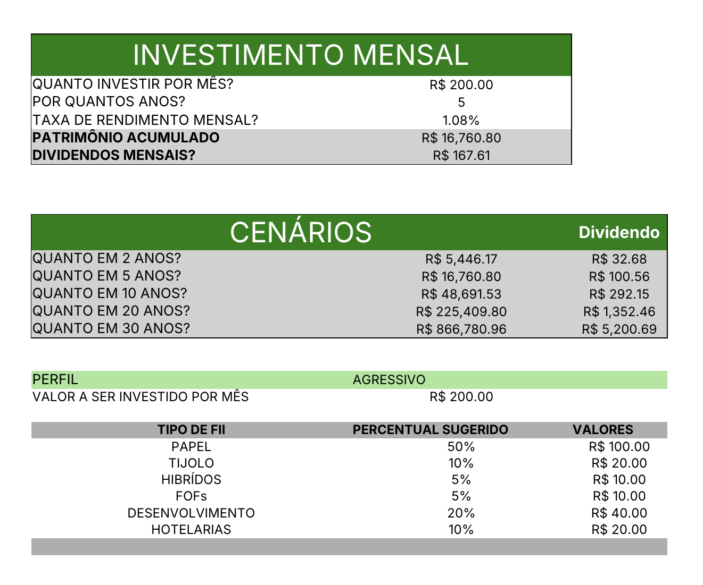

# Controle de Investimentos em FIIs (Excel)

Planilha que simula o crescimento de investimentos mensais e sugere como dividir o aporte entre tipos de fundos imobiliários (FIIs), conforme o perfil do investidor.

Projeto prático do curso "Criando uma Ferramenta de Controle de Investimentos com Excel" (DIO).

## O que a planilha faz

- **Simulação de patrimônio:** a partir do valor investido por mês, do prazo em anos e da taxa de rendimento mensal, calcula o patrimônio acumulado e os dividendos mensais.
- **Cenários:** mostra o resultado para 2, 5, 10, 20 e 30 anos.
- **Perfil do investidor:** o usuário escolhe entre conservador, moderado ou agressivo.
- **Distribuição do aporte:** para cada perfil, sugere o percentual e o valor por tipo de FII: papel, tijolo, híbridos, fundos de fundos (FOFs), desenvolvimento e hotelarias.

## Como funciona

- A função **FV** calcula o patrimônio acumulado e os cenários.
- Uma segunda aba guarda a tabela de percentuais por perfil e tipo de fundo.
- **PROCV** busca nessa tabela o percentual certo, usando uma chave que junta perfil e tipo de FII.
- **Nomes definidos** (como `Aporte` e `Taxa_Mensal`) deixam as fórmulas mais legíveis.

## Como usar

1. Abra o arquivo `controle-de-investimentos.xlsx`.
2. Preencha o valor mensal, o prazo e a taxa de rendimento.
3. Escolha o perfil de investidor.
4. Veja o patrimônio, os cenários e a distribuição sugerida.

## Aviso

Projeto educacional. Os valores são exemplos e não são recomendação de investimento.

## Próximos passos

- Adicionar gráficos de evolução do patrimônio.
- Refazer a análise em Python (Pandas).

## Autor

Felipe Lira — [LinkedIn](https://www.linkedin.com/in/felipe-liraah)
